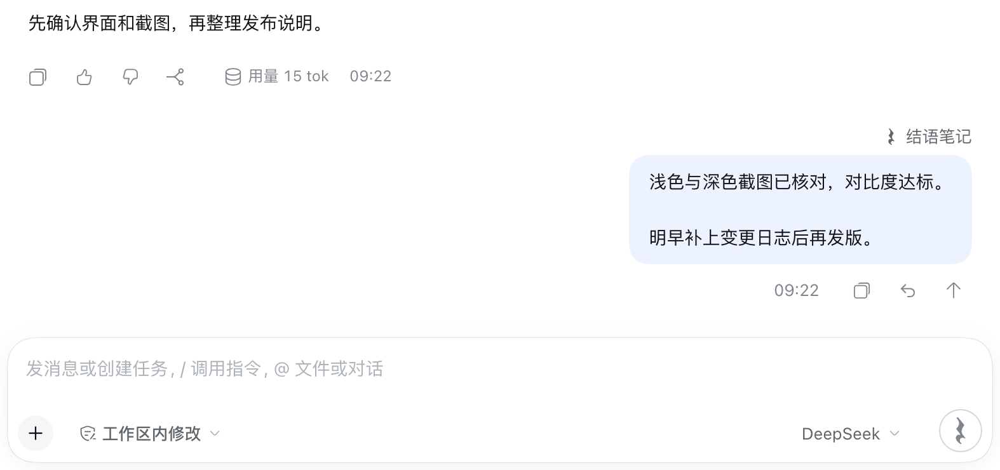
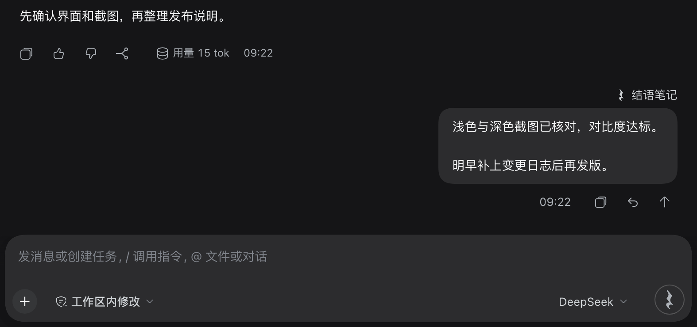

# Caesura

[简体中文](README.zh.md)

Save a private closing note at the end of a conversation to record progress or takeaways without continuing the turn.

- After a turn finishes, hold `Mod` (`⌘` on macOS, `Ctrl` on Windows/Linux) and click `𝄽`
  or press `Mod+Enter` to save the first closing note.
- Once a note exists, `𝄽` stays at the send slot so clicking it or pressing `Enter` appends your draft (preserving text,
  `@` mentions, quotes, and files in this browser).
- Use **Copy**, **Rewind** (restores to an empty composer for editing), or **Send** (submits as a message,
  including leading slash text) beside the saved timestamp.

Requires DeepSeek Harness `0.2.2-rc.5`. Enable **Caesura · Closing note** in **Session Modular Improvement Plan**,
or run `pnpm install` in this directory and select it in **Plugins → Add plugin**.

## Screenshots

A saved two-paragraph closing note at turn end with **Copy**, **Rewind**, and **Send** actions,
and the persistent `𝄽` rest button in the composer (Chinese UI).

| | Light | Dark |
| --- | --- | --- |
| Closing note & rest button |  |  |

[Project documentation](docs/README.md)
